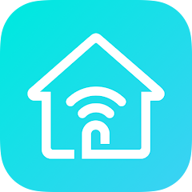

  # 📡 WiFi & Router Remote Control Hub
  **All-in-one collection of official router management apps, direct APKs, and network utilities.**

  
  
  

---

## 📱 Supported Router Management Apps

Easily configure your WiFi name (SSID), change passwords, block unknown devices, and monitor network speed directly from your smartphone.

<table>
  <thead>
    <tr>
      <th align="center" width="90px">Logo</th>
      <th align="left" width="180px">App & Brand</th>
      <th align="left">Key Features & Details</th>
      <th align="center" width="170px">Download Links</th>
    </tr>
  </thead>
  <tbody>
    <!-- TP-LINK TETHER -->
    <tr>
      <td align="center">
        
      </td>
      <td>
        <strong>TP-Link Tether</strong> 
        Brand: TP-Link
      </td>
      <td>
        Setup and manage TP-Link routers, xDSL routers, and range extenders. Block unauthorized users, set parental controls, and optimize signal placement.
      </td>
      <td align="center">
          
        
      </td>
    </tr>
    <!-- TENDA WIFI -->
    <tr>
      <td align="center">
        
      </td>
      <td>
        <strong>Tenda WiFi</strong> 
        Brand: Tenda
      </td>
      <td>
        Smart home network management for Tenda routers. Supports remote cloud management, bandwidth control, guest network setup, and one-click optimization.
      </td>
      <td align="center">
          
        
      </td>
    </tr>
    <!-- BEE WIFI -->
    <tr>
      <td align="center">
        
      </td>
      <td>
        <strong>BeeWiFi</strong> 
        Brand: Netis / Bee
      </td>
      <td>
        Lightweight utility for configuring Netis & Bee routers without complex web portals. Easily view connected clients, adjust WiFi settings, and monitor status.
      </td>
      <td align="center">
          
        
      </td>
    </tr>
    <!-- RUIJIE REYEE -->
    <tr>
      <td align="center">
        
      </td>
      <td>
        <strong>Ruijie Reyee</strong> 
        Brand: Ruijie Networks
      </td>
      <td>
        Enterprise & home cloud management for Ruijie Reyee routers and access points. Features topology visualization, mesh pairing, and remote diagnostics.
      </td>
      <td align="center">
          
        
      </td>
    </tr>
  </tbody>
</table>

---

## 🛠️ Quick Setup Guide

1. **Connect to WiFi:** Ensure your phone is connected to the router's local network.
2. **Install App:** Use the **Direct APK** button or the **Play Store** button above.
3. **Log In:** Open the app and log in using your admin credentials.
